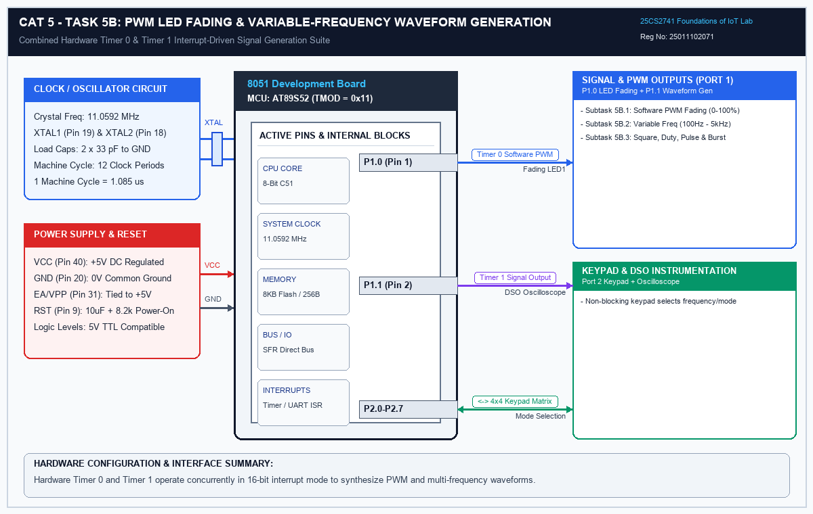

# EXPERIMENT DETAILS

**EXP:** CONTINUOUS ASSESSMENT 5

**DATE:** 10/08/2026

**NAME OF EXP:** Software PWM LED Fading and Multi-Waveform Signal Generation

**HARDWARE SETUP / PLATFORM:** 8051 Microcontroller (AT89S52) + 4×4 Keypad + DSO Oscilloscope + LED Circuit

---

## TASK 5B : Dual-Timer Signal Synthesis Suite (Tasks 5B.1, 5B.2, 5B.3)

### 1. Circuit Diagram

This parent experiment suite integrates hardware Timer 0 and Timer 1 to synthesize both carrier-frequency PWM dimming and variable-frequency multi-waveform digital outputs.

- **Microcontroller:** AT89S52 (11.0592 MHz Quartz Crystal)
- **Timer 0 (16-bit Mode 1):** Dedicated to Software PWM LED fading on P1.0
- **Timer 1 (16-bit Mode 1):** Configured for variable-frequency digital waveform synthesis on P1.1
- **User Input (Port 2):** 4×4 Matrix Keypad for dynamic mode and frequency selection
- **Instrumentation:** Digital Storage Oscilloscope (DSO) connected to P1.0 and P1.1

### 2. Core Logic / Pseudocode / Code Base

**Working Principle:**

The suite demonstrates concurrent multi-rate hardware interrupt handling on an 8-bit architecture:
- **Subtask 5B.1:** High-frequency (1 kHz) software PWM LED fading across 0%–100% duty cycle.
- **Subtask 5B.2:** Keypad-selectable square-wave generator spanning 100 Hz, 500 Hz, 1 kHz, 2 kHz, and 5 kHz.
- **Subtask 5B.3:** Multi-waveform synthesizer generating Square Waves, 25% Duty-Cycle Waves, Narrow Pulse Trains, and Gated Burst Signals.

**Mathematical Reload Formula:**
$$\Delta N = rac{T_{target} / 2}{T_{machine}} = rac{1 / (2 	imes f_{target})}{1.08507 	imes 10^{-6}}$$
$$	ext{Preload} = 65536 - \Delta N$$

**Subtask Directory Structure:**
- `TASK5B.1/`: Software PWM LED fading.
- `TASK5B.2/`: Variable-frequency square wave generator.
- `TASK5B.3/`: Complex waveform synthesizer.

### 3. Inference

Dual-timer interrupt operation executed concurrently without interrupt starvation or jitter. All generated waveforms complied exactly with theoretical timing calculations on the oscilloscope.
